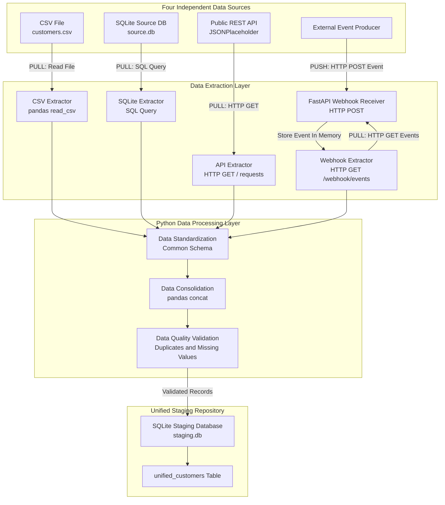

# Unified Multi-Source Data Ingestion Pipeline

## 1. Project Overview

This project demonstrates how data from multiple independent systems can be collected, standardized, validated, and stored in one unified staging repository.

Organizations rarely maintain all their data in a single location. Customer information may be stored in CSV files, operational applications may use relational databases, external services may expose REST APIs, and business applications may send events through webhooks or message queues.

The objective of this project is to build a local multi-source data ingestion pipeline using Python. It demonstrates different data integration patterns, including file-based extraction, database querying, API integration, and event-driven data delivery.

The pipeline integrates four mock data sources:

1. **CSV File:** Customer records stored in a local comma-separated values file.
2. **SQLite Database:** Customer records stored in a local relational database.
3. **Public REST API:** User records retrieved from JSONPlaceholder.
4. **Webhook Simulator:** Customer events pushed to a local FastAPI endpoint.

The extracted records are mapped to a common customer schema, combined into one pandas DataFrame, checked for basic data-quality issues, and loaded into a SQLite staging database.

## 2. Project Objectives

The main objectives are to:

- Set up a reproducible local Python development environment.
- Connect to four different source-system patterns.
- Extract structured data from files, databases, APIs, and pushed events.
- Standardize different field names and data types into a common schema.
- Consolidate records from all sources into one dataset.
- Perform basic data-quality checks.
- Load consolidated data into a centralized staging repository.
- Understand pull-based and push-based ingestion patterns.
- Implement automated tests for standardization and ingestion logic.
- Document the architecture and compare batch and real-time ingestion systems.

## 3. Concepts Explained

### 3.1 Data Ingestion

Data ingestion is the process of collecting data from one or more source systems and bringing it into a target environment for further processing, analytics, or storage.

An ingestion pipeline commonly includes:

1. Extraction
2. Transformation or standardization
3. Data consolidation
4. Data-quality validation
5. Loading

### 3.2 Source Systems

A source system is the original location or application from which data is collected.

This project uses four source types:

| Source   | What It Represents                          | Integration Approach       |
| -------- | ------------------------------------------- | -------------------------- |
| CSV      | File-based data exchange                    | Read a local file          |
| SQLite   | Relational database                         | Execute a SQL query        |
| REST API | External application or service             | Send an HTTP GET request   |
| Webhook  | Event notification from another application | Receive an HTTP POST event |

### 3.3 Pull-Based Ingestion

In pull-based ingestion, the ingestion process initiates a request to retrieve data from a source system.

Examples in this project:

- Reading the CSV file.
- Querying the SQLite database.
- Sending a GET request to the public REST API.
- Sending a GET request to retrieve events already received by the webhook simulator.

The ingestion process controls when it retrieves the data.

### 3.4 Push-Based Ingestion

In push-based ingestion, an external system sends data to an endpoint when an event occurs.

The local webhook simulator demonstrates this approach. A client sends a POST request to the FastAPI endpoint, and the application receives and stores the event in memory.

The pipeline later retrieves the received events through the webhook GET endpoint.

Therefore, event delivery is push-based, while the pipeline's collection of the stored event list is pull-based.

### 3.5 Data Standardization

Different source systems can represent the same business information using different field names and formats.

For example:

| Source   | Original Customer-Name Field | Standardized Field |
| -------- | ---------------------------- | ------------------ |
| CSV      | `full_name`                  | `full_name`        |
| SQLite   | `customer_name`              | `full_name`        |
| REST API | `name`                       | `full_name`        |
| Webhook  | `full_name`                  | `full_name`        |

Standardization maps these source-specific structures to a common schema.

### 3.6 Unified Staging Repository

A staging repository is a centralized location where extracted and standardized data is stored before downstream transformations, analytics, or reporting.

This project uses SQLite for the staging repository. The consolidated data is stored in the `unified_customers` table.

The current loader uses a full-refresh approach: it replaces the staging table on each run rather than incrementally appending records.

## 4. Technology Stack

| Technology      | Purpose                                                                                      |
| --------------- | -------------------------------------------------------------------------------------------- |
| Python          | Main programming language                                                                    |
| pandas          | Data extraction, transformation, standardization, and consolidation                          |
| requests        | HTTP communication with REST endpoints                                                       |
| SQLite          | Local source database and staging repository                                                 |
| FastAPI         | Local webhook receiver                                                                       |
| Uvicorn         | Local ASGI server for FastAPI                                                                |
| email-validator | Email validation in webhook request models                                                   |
| pytest          | Automated testing                                                                            |
| SQLAlchemy      | Installed in the project environment; not currently required by the ingestion implementation |
| VS Code         | Development environment                                                                      |
| Git and GitHub  | Version control and project hosting                                                          |

## 5. Development Environment Setup

### Step 1: Create the Project Directory

Create a project directory named:

```text
multi-source-data-ingestion
```

Open this directory in Visual Studio Code.

### Step 2: Create a Python Virtual Environment

Create a virtual environment named `.venv` in the project root:

```cmd
python -m venv .venv
```

Activate the environment:

**Windows CMD:**

```cmd
.venv\Scripts\activate
```

**Windows PowerShell:**

```powershell
.\.venv\Scripts\Activate.ps1
```

### Step 3: Install Project Dependencies

Install the packages recorded in `requirements.txt`:

```cmd
pip install -r requirements.txt
```

The primary dependencies include pandas, requests, FastAPI, Uvicorn, email-validator, and pytest.

### Step 4: Prepare the Source and Staging Directories

Create separate directories for:

- CSV source files.
- SQLite source database.
- Staging database.
- Source extraction modules.
- Transformation modules.
- Loader modules.
- Webhook application.
- Automated tests.
- Project documentation.

### Step 5: Generate the SQLite Source Database

Run the SQLite database setup utility:

```cmd
python data\sqlite\create_source_db.py
```

This utility creates the source database and its customer table and inserts sample customer records.

The generated database is stored under the SQLite data directory.

## 6. Data Source Implementation

### Step 6: Configure the CSV Source

The CSV source contains sample customer records.

It includes:

- Customer ID
- Full name
- Email address
- City
- Customer creation date

The extraction module reads the file into a pandas DataFrame using `pandas.read_csv()`.

### Step 7: Configure the SQLite Source

The local SQLite source database contains customer records.

Its table uses source-specific field names, including:

- `customer_name`
- `country`
- `registration_date`

The extraction module executes a SQL query and loads the results into a pandas DataFrame.

### Step 8: Configure the REST API Source

The project uses the JSONPlaceholder public users endpoint:

https://jsonplaceholder.typicode.com/users

The extraction module:

1. Sends an HTTP GET request.
2. Checks the HTTP response status.
3. Parses the JSON response.
4. Converts the returned records into a pandas DataFrame.

The API returns ten user records.

The API response contains nested address information. The extraction process normalizes nested JSON fields so that the city can be accessed as a regular DataFrame column.

### Step 9: Configure the Webhook Simulator

The webhook application is implemented using FastAPI.

It provides:

- A health endpoint.
- A POST endpoint to receive customer events.
- A GET endpoint to retrieve received events.

The POST endpoint validates the incoming event, adds source and ingestion-time metadata, and stores the event in an in-memory collection.

The interactive API documentation is available at:

http://127.0.0.1:8000/docs

**Important:** The current simulator is intentionally simple. Received events are lost when the FastAPI process restarts because they are not persisted to a database or durable message broker.

## 7. Standardization and Consolidation

### Step 10: Standardize the Source Records

The standardization module maps the four source-specific structures to a common set of fields.

The standardized schema is:

| Column        | Description                                             |
| ------------- | ------------------------------------------------------- |
| `source_id`   | Original identifier from the source system              |
| `full_name`   | Customer or user name                                   |
| `email`       | Email address                                           |
| `location`    | City or country value supplied by the source            |
| `created_at`  | Customer creation or registration date, when available  |
| `source`      | Name of the originating source                          |
| `ingested_at` | Timestamp at which the pipeline standardized the record |

The pipeline also creates a unique source-qualified `record_id`.

For example, a CSV record with source ID `C001` becomes:

```text
csv_C001
```

Timestamps are converted to UTC-aware datetime values. Invalid or unavailable dates are represented as missing datetime values rather than fabricated.

**Known source differences:**

- The REST API does not provide a customer registration date, so its `created_at` values are missing.
- The SQLite source provides a country, while the other sources provide city-level locations. The current common `location` field therefore has mixed geographic granularity.

### Step 11: Consolidate the Records

The standardized DataFrames are combined into one unified pandas DataFrame.

The resulting dataset includes a `source` field so that records can be traced to their original systems.

### Step 12: Validate Data Quality

The pipeline currently checks:

- Total record count.
- Duplicate record IDs.
- Missing email addresses.
- Missing customer names.
- Missing locations.

Duplicate record IDs cause the pipeline to stop before loading the staging repository.

## 8. Load the Unified Staging Repository

### Step 13: Load Standardized Data

The staging loader creates the staging directory when necessary and loads the unified DataFrame into a SQLite database.

**Staging database:**

```text
data/staging/staging.db
```

**Staging table:**

```text
unified_customers
```

The current implementation uses a full refresh. Each successful pipeline execution replaces the existing staging table with the latest consolidated dataset.

This makes repeated development runs predictable, but it is not an incremental or historical ingestion design.

## 9. Running the Project

### Step 14: Start the Webhook Server

Open a terminal in the project root, activate the virtual environment, and start the FastAPI application:

```cmd
uvicorn webhook.app:app --reload
```

Keep this terminal running while testing webhook ingestion.

The interactive API documentation is available at:

http://127.0.0.1:8000/docs

### Step 15: Submit a Webhook Event

Use the interactive API documentation to send a POST request to:

```text
POST /webhook/customers
```

Example event:

```json
{
  "customer_id": "W001",
  "full_name": "Aarav Sharma",
  "email": "aarav@example.com",
  "city": "Panchkula",
  "created_at": "2026-03-01"
}
```

After submitting the event, retrieve the event list using:

```text
GET /webhook/events
```

Confirm that the event appears in the response.

**Important:** The webhook event collection is held in memory. If the server restarts, submit the test event again before running the ingestion pipeline.

### Step 16: Run the Unified Ingestion Pipeline

Open a second terminal in the project root, activate the virtual environment, and run:

```cmd
python src\main.py
```

The pipeline:

1. Extracts data from all four sources.
2. Standardizes the records.
3. Consolidates the records.
4. Performs data-quality validation.
5. Loads the unified dataset into the staging database.

### Step 17: Verify the Staging Repository

Verify the staging database exists:

```powershell
Test-Path .\data\staging\staging.db
```

Verify the total record count and source-wise distribution:

```cmd
python -c "import sqlite3; c=sqlite3.connect('data/staging/staging.db'); print('Total records:', c.execute('SELECT COUNT(*) FROM unified_customers').fetchone()[0]); print('Source-wise counts:'); print(*c.execute('SELECT source, COUNT(*) FROM unified_customers GROUP BY source ORDER BY source').fetchall(), sep='\n'); c.close()"
```

The sample dataset contains the following source records:

| Source    | Expected Records |
| --------- | ---------------: |
| CSV       |                8 |
| SQLite    |                5 |
| REST API  |               10 |
| Webhook   |                1 |
| **Total** |           **24** |

Check for duplicate record IDs:

```cmd
python -c "import sqlite3; c=sqlite3.connect('data/staging/staging.db'); print('Duplicate record IDs:', c.execute('SELECT COUNT(*) FROM (SELECT record_id FROM unified_customers GROUP BY record_id HAVING COUNT(*) > 1)').fetchone()[0]); c.close()"
```

Inspect the staging table schema:

```cmd
python -c "import sqlite3; c=sqlite3.connect('data/staging/staging.db'); print(*c.execute('PRAGMA table_info(unified_customers)').fetchall(), sep='\n'); c.close()"
```

These checks help verify that the records have been persisted in the staging repository and that the expected table structure is available.

## 10. Automated Testing

The project uses pytest for automated testing.

The test suite is located in the `tests` directory.

### 10.1 Test Structure

```text
tests/
├── conftest.py
├── test_standardize.py
└── test_ingestion.py
```

### 10.2 Standardization Tests

The standardization tests verify:

- CSV record standardization.
- SQLite record standardization.
- REST API record standardization.
- Webhook event standardization.
- Conversion of source IDs to strings.
- Handling of unavailable or invalid dates.
- Rejection of unsupported source names.

### 10.3 Ingestion Tests

The ingestion tests verify:

- Consolidation of records from all four sources.
- Creation of source-qualified record IDs.
- Passing the unified DataFrame to the staging loader.
- Rejection of duplicate record IDs before loading.

The pipeline tests replace the external extractors and staging loader with controlled test doubles. They therefore do not require a live public API, a running webhook server, or a real staging database.

### 10.4 Running Automated Tests

Run all tests from the project root:

```cmd
python -m pytest tests -v
```

Run only standardization tests:

```cmd
python -m pytest tests\test_standardize.py -v
```

Run only ingestion tests:

```cmd
python -m pytest tests\test_ingestion.py -v
```

The test suite covers 11 automated test cases across standardization and ingestion logic.

## 11. System Architecture

The architecture illustrates how the four source systems connect to the Python ingestion pipeline and how the standardized data reaches the unified staging repository.

### 11.1 Architecture Diagram



### 11.2 Architecture Explanation

**Source Layer:** Four independent systems provide customer or user information in different formats.

**Extraction Layer:** Python modules retrieve records from CSV, SQLite, and the REST API. The FastAPI application receives pushed webhook events and exposes them through a GET endpoint.

**Processing Layer:** Extracted data is standardized into a common schema, consolidated into one pandas DataFrame, and checked for basic data-quality issues.

**Staging Layer:** Validated records are loaded into the SQLite staging database and stored in the `unified_customers` table.

### 11.3 Pull Versus Push Data Flows

| Source                  | Data Movement                                  | Pattern |
| ----------------------- | ---------------------------------------------- | ------- |
| CSV                     | Pipeline reads the local file                  | Pull    |
| SQLite                  | Pipeline executes a SQL query                  | Pull    |
| REST API                | Pipeline sends HTTP GET                        | Pull    |
| Webhook                 | External producer sends HTTP POST              | Push    |
| Webhook event retrieval | Pipeline requests stored events using HTTP GET | Pull    |

The webhook has both push and pull interactions: the event producer pushes an event to the receiver, and the ingestion pipeline later retrieves the stored events.

## 12. Batch-Oriented File Storage vs Real-Time Event-Driven Systems

Batch-oriented file storage and real-time event-driven systems are two common approaches to data ingestion.

**Batch-oriented file storage** collects data over a defined period and processes it in scheduled groups. Data is commonly exchanged through CSV, JSON, Parquet, or other files. The ingestion process runs at scheduled intervals, such as hourly, daily, or weekly. Batch processing is relatively straightforward to implement, cost-effective for large volumes of historical data, and suitable for reporting, data warehousing, and periodic analytics. However, information may not become available immediately because processing waits for the next scheduled batch.

**Real-time event-driven systems** process data when events occur. Applications publish events through webhooks, message brokers, or streaming platforms such as Kafka and RabbitMQ. Consumers receive and process these events continuously or in near real time. This approach provides lower latency and supports use cases such as fraud detection, live monitoring, transaction alerts, and operational dashboards. However, it introduces additional complexity involving message delivery, ordering, retries, duplicate handling, fault tolerance, and monitoring.

The main difference is data freshness versus processing simplicity. Batch processing is often preferable when periodic updates are sufficient, while event-driven ingestion is useful when immediate responses are important. Many modern data platforms combine both approaches to balance operational efficiency, scalability, and freshness.

## 13. Data Validation and Verification

The ingestion pipeline performs basic validation before loading the consolidated dataset.

| Validation               | Description                                             |
| ------------------------ | ------------------------------------------------------- |
| Record count             | Checks the number of extracted and consolidated records |
| Duplicate record IDs     | Identifies duplicate source-qualified identifiers       |
| Missing emails           | Checks for missing email addresses                      |
| Missing names            | Checks for missing customer or user names               |
| Missing locations        | Checks for missing location values                      |
| Staging record count     | Verifies the number of records stored in SQLite         |
| Source-wise distribution | Checks how many records came from each source           |
| Table schema             | Verifies the structure of the staging table             |

The staging repository can also be queried directly using SQLite to independently verify the stored data.

## 14. Project Folder Structure

```text
multi-source-data-ingestion/
│
├── .venv/
│
├── data/
│   ├── csv/
│   │   └── customers.csv
│   │
│   ├── sqlite/
│   │   ├── create_source_db.py
│   │   └── source.db
│   │
│   └── staging/
│       └── staging.db
│
├── docs/
│
├── src/
│   ├── sources/
│   │   ├── csv_source.py
│   │   ├── sqlite_source.py
│   │   ├── api_source.py
│   │   └── webhook_source.py
│   │
│   ├── transformations/
│   │   └── standardize.py
│   │
│   ├── loaders/
│   │   └── staging_loader.py
│   │
│   └── main.py
│
├── webhook/
│   └── app.py
│
├── tests/
│   ├── conftest.py
│   ├── test_standardize.py
│   └── test_ingestion.py
│
├── .gitignore
├── requirements.txt
└── README.md
```

The `.venv` directory and generated database files are local development artifacts. They can be recreated using the project setup scripts and should generally be excluded from version control.

## 15. Known Limitations

1. **Webhook Persistence:** Events are held in memory and disappear when the webhook server restarts.
2. **Full-Refresh Loading:** The staging loader replaces the table on every run; it does not implement incremental loading or historical record preservation.
3. **API Date Availability:** The public API does not provide a customer registration date for the selected records.
4. **Location Consistency:** The standardized location field mixes city-level and country-level values.
5. **External API Dependency:** REST API extraction depends on network availability and the external service.
6. **Basic Validation:** The current checks cover duplicates and missing key fields but do not implement a complete data-quality framework.
7. **Event Processing:** The webhook simulator is not a durable message queue and does not provide retries, acknowledgements, or dead-letter handling.
8. **Test Scope:** Automated pipeline tests use mocked extractors and a mocked loader. They do not replace live integration tests of the external API, webhook service, or staging database.

## 16. Future Improvements

Possible extensions beyond the current implementation include:

- Persist webhook events in SQLite instead of memory.
- Introduce a real message broker such as RabbitMQ or Kafka.
- Add incremental ingestion and idempotent loading.
- Add structured logging and retry mechanisms.
- Introduce schema validation and more comprehensive data-quality rules.
- Add source-level monitoring and ingestion metrics.
- Move the staging repository to PostgreSQL or a cloud data warehouse.
- Implement integration tests for real source connections.
- Add automated test coverage reporting.

## 17. Conclusion

This project demonstrates a foundational multi-source data-ingestion workflow. It integrates file-based, relational database, REST API, and webhook-based sources into one standardized staging repository.

It also demonstrates the distinction between pull-based data extraction and push-based event delivery, along with data consolidation, basic data-quality validation, and automated testing.

The implementation provides a foundation for more advanced ETL/ELT pipelines, real-time data integration, and analytics engineering workflows.
